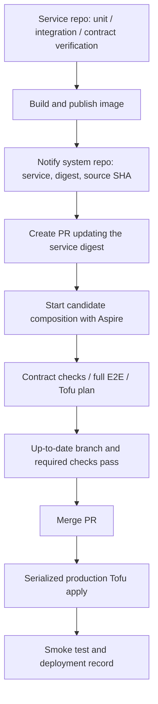

# How to deploy to cloud

この文書は初期のクラウド構成と、サービスを独立 repository へ分離した後の設計方針を扱う。
`Service boundaries and polyrepo delivery` は合意した移行先の設計であり、CI/CD の実装済み状態を
示すものではない。移行後の repository 所有権とリリース方式は同節を正とする。

TODO: あとでmarmaidにすること

hosts:
- https://jobdeck.app.air-hand.com/
- https://demo.jobdeck.app.air-hand.com/

ui service (BFF) のみを外部公開する

GCP SecretManagerに保存し、それぞれ環境変数として注入する
- JWT生成鍵
- workerのclient_id, client_secret

コストがかかるためCloudSQLは使わず、job-api, auth Cloud Runのsidecarコンテナとして配置し、揮発することは許容する。

Cloud Runにはone-shot init containerがないため、migratorはapp containerのentrypointでserver起動前に実行する。

SSRFや脆弱性を回避するため、job-workerはforward proxyを通してリクエストを送信することとし、squidをsidecarとして構築し、allowlistで強制する

private/link-local IP、DNS rebindingを拒否する

proxy-bypassはsidecarでは完全に防ぐことはできないので注意

ui serviceはsessionをmemoryで管理しているため、スケールさせずに1 containerのみとする。(いずれにせよ、スケールさせるにはValkeyなどを外に出す必要がある)

リクエスト実行先として、簡単なDemo Appを用意し、様々なパターンに対応できるようにしておく。E2E testの検証先としても利用予定。

## Initial GCP deployment

初期の GCP project は `airhand-jobdeck`、region は `asia-northeast1` (Tokyo) とする。

### IaC layout and state

初期構成では IaC はこの monorepo の `iac/` に置き、OpenTofu を使用する。Terragrunt は導入しない。
polyrepo 移行後は全体構成を所有する `jobdeck-system` repository に置き、当面は以下の root と
state の境界を維持する。サービス repository の分離だけを理由に state は分割しない。

```text
iac/
  bootstrap/  # Artifact Registry, Secret Manager, IAM, GitHub OIDC, Cloud DNS, KMS
  app/        # Cloud Run, Scheduler, load balancer, DNS records
```

分割は依存関係と lifecycle を明示するためである。`app` は任意のタイミングで
destroy/apply できる一方、`bootstrap` は state、image repository、deploy identity、
secret の器を維持する。

OpenTofu state は手動で作成する GCS bucket を backend として利用する。backend は
`tofu init` より前に存在する必要があるため、この bucket 自体を同じ state で管理・
import しない。bucket の作成と初期操作者への権限付与だけを最小の手動 bootstrap とする。
bucket は object versioning と uniform bucket-level access を有効にする。state の prefix は
`bootstrap/` と `app/` に分ける。

`app` state と plan は `tofu-state` GCP KMS key を用いた OpenTofu encryption で暗号化する。
KMS key は `bootstrap` が管理し、削除保護と rotation を有効にする。`bootstrap` state は、その
apply が作る KMS key で暗号化できないため OpenTofu encryption の対象外とし、secret value を
含めない。GCS bucket の Google 所有鍵による at-rest encryption、uniform bucket-level access、
public access prevention、object versioning を基礎保護とする。

### Secret management

Secret Manager の secret resource と IAM は OpenTofu で管理する。secret value は
`google_secret_manager_secret_version.secret_data_wo` を使用して write-only で投入し、
state に保存しない。

secret source は `sops` GCP KMS key で暗号化した `iac/secrets/*.enc.yaml` とする。CI は
GitHub OIDC で deploy service account を impersonate し、一時ファイルへ復号した値を
OpenTofu の write-only input として渡す。一時ファイルは apply 後に削除する。OpenTofu
configuration 内の SOPS data source は使わない。復号済み data source が state に残ることを
避けるためである。

Secret Manager の secret container と runtime service account ごとの accessor IAM は
`bootstrap` が管理する。`app` deployer は各既存 secret への version 追加だけを許可し、secret
container の作成や runtime IAM policy の変更は行えない。これは secret 名と consumer の対応を
長期的な基盤契約として固定するためである。

### Image and deployment flow

以下は移行前の共通 release tag による方式である。polyrepo 移行では、後述するサービス別の
image digest 更新 PR と、system repository での E2E 検証・デプロイに置き換える。

Terraform Docker provider は使わない。CI が各 image を build し、Artifact Registry へ
release tag (`vX.Y.Z`) を push する。repository は immutable tag を有効にし、OpenTofu は
release tag を variable として受け取って Cloud Run revision を固定する。

```text
main merge
  -> release-please creates / updates a release PR
  -> release PR merge creates the release and vX.Y.Z tag
  -> GitHub Release published
  -> build / push vX.Y.Z images to Artifact Registry
  -> decrypt SOPS secrets
  -> tofu apply iac/app with immutable image tags
```

`bootstrap` の apply は基盤変更時に別途実行し、毎回のサービス release の前提ステップにはしない。

`_tofu` は `root` と `command` を受け取る reusable workflow であり、release publish 時、PR CI
の infrastructure plan、必要時の手動 apply から呼ぶ。backend prefix は `root` (`bootstrap` または
`app`) とし、認証 service account は選択した GitHub Environment の
`GCP_SERVICE_ACCOUNT` をそのまま使う。workflow は誤用防止のため、
`plan/bootstrap/plan`、`apply/bootstrap/bootstrap`、`plan/app/plan`、
`apply/app/production` の command/root/environment 組み合わせだけを許可する。
destroy workflow は `iac/app` だけに対して実行する。bootstrap resource と state は削除しない。

PR の infrastructure plan は、手動で作成する専用の `jobdeck-plan` service account を GitHub
Environment `plan` の OIDC binding で利用する。同 SA は project/IAM policy の read、state bucket
の read、state lock object の create/delete、state KMS key の decrypt のみを持つ。`_ci` の子 job と
して実行し、fork PR ではスキップする。

### Runtime topology

```text
Internet
  -> HTTPS Load Balancer
     -> ui: jobdeck.app.air-hand.com
     -> demo: demo.jobdeck.app.air-hand.com

ui Cloud Run service
  -> job-api Cloud Run service + PostgreSQL sidecar
  -> auth Cloud Run service + PostgreSQL sidecar

Cloud Scheduler
  -> job-worker Cloud Run Job + Squid sidecar
     -> job-api / auth / allowlisted demo endpoint
```

`ui` と `demo` だけを外部公開する。`auth` と `job-api` は internal ingress とする。
PostgreSQL は各 service instance に閉じた揮発 DB であり、`max instances = 1` とする。
インスタンス再作成時にデータが失われることを明示的に許容する。

Cloud Run は one-shot init container を持たないため、migrator は sidecar にしない。PostgreSQL
sidecar の startup healthcheck 後に app container を開始し、entrypoint で `migrator up` を
実行してから server process を `exec` する。これにより listener を開く前に migration が完了する。

worker は初期段階では Cloud Scheduler から起動する Cloud Run Job とする。無限 polling の
代わりに `-once` で claim 済みの execution を処理・report して終了する。Pub/Sub 導入後は、
enqueue 時に publish し、Cloud Run service の push subscription で worker を message 数に
応じて scale させる。

### DNS

Route 53 の `air-hand.com` zone から `jobdeck.app.air-hand.com` だけを Cloud DNS managed
zone へ委任する。bootstrap apply が Cloud DNS nameserver を出力し、一度だけ Route 53 に NS
record を設定する。以後、`jobdeck.app.air-hand.com` と
`demo.jobdeck.app.air-hand.com` の record は OpenTofu が Cloud DNS で管理する。

Cloud Run domain mapping は Preview のため使わない。global external HTTPS Load Balancer、
serverless NEG、Google-managed certificate を IaC 管理し、2 host をそれぞれ `ui` と `demo` に
route する。

### Edge protection

load balancer / DNS の slice では、`ui` と `demo` の external HTTPS Load Balancer backend service に
共有の Cloud Armor Standard policy を 1 つ接続する。初期 rule は明示的な protocol / IP deny と
rate limiting に限定し、OWASP preconfigured WAF rule は実トラフィックと false positive の挙動を
観測してから preview・enforce を判断する。これは公開 endpoint の基本的な防御を先に確保する一方で、
Cloud Armor の固定費、rule ごとの費用、誤検知対応という運用コストを増やしすぎないための判断である。

### Service boundaries and polyrepo delivery

`services/` 以下は、それぞれ独立した repository・image・release cadence に分離する。
protobuf は既に `air-hand-org/api-contracts` に切り出している。次に auth を分離し、同じ方式を
残りのサービスへ適用する。サービスの release（image 公開）と production への deployment は
別の処理とし、他サービスの release を待たずに単独で更新できる構成にする。
サービス間では内部 package や他サービスの DB を直接参照せず、公開した API / message を契約とする。
例えば `job-worker` は `job-api` の内部実装や DB に依存せず、生成済み protobuf client で通信する。

#### Repository ownership

| Repository | Responsibility |
| --- | --- |
| `api-contracts` | protobuf schema、生成 SDK、lint / breaking change detection |
| 各 service repository | 実装、DB migration、Dockerfile、unit / integration test、consumer contract と provider verification |
| `jobdeck-system` | 全体 Aspire AppHost、全体 E2E、IaC、環境別 image digest 一覧、更新 PR と deployment workflow |

`jobdeck-system` は論理的な役割名であり、現在の `jobdeck` repository からサービスを順に
切り出して、この役割を残す形でもよい。UI repository に全体 AppHost や全体 E2E を置かない。
サービス単体の integration test に必要な DB 起動や fixture は各 service repository が所有する。

```text
jobdeck-system/
  apphosts/
  tests/e2e/
  environments/
    production.yaml
  iac/
    bootstrap/
    app/
  .github/workflows/
```

Aspire と OpenTofu はそれぞれローカル環境とクラウド環境の配線を表現するが、使用する
サービス image は同じ環境別一覧から読み取る。一覧の形式は実装時に確定する。
以下は例であり、digest は説明用のプレースホルダーである。

```yaml
images:
  auth: registry/auth@sha256:...
  ui: registry/ui@sha256:...
  job-api: registry/job-api@sha256:...
  job-worker: registry/job-worker@sha256:...
  demo: registry/demo@sha256:...
  forward-proxy: registry/forward-proxy@sha256:...
```

共通の `image_tag` を全サービスへ適用する方式を廃止し、各 image を digest で固定する。
release tag は人が識別するために残してもよいが、E2E と deployment の対象は digest とする。
サービスが利用する `api-contracts` / SDK のバージョンも各 repository で固定する。

#### Image publication and promotion PR



サービス側は image 公開後に system repository へ通知するまでを担当する。通知は
`repository_dispatch` の `image_published` イベントを基本案とし、service 名、image digest、
source commit SHA、release の参照を渡す。特定 workflow の入力として呼び出す
`workflow_dispatch` でも実現できる。更新対象ファイルや PR 作成の処理は system 側が所有する。
同じ通知の再送で重複 PR を作らないよう、service と digest で更新要求を識別する。

repo 間の通知と PR 作成には、必要な repository に権限を付与した GitHub App installation token を
使用する。dispatch の受信 workflow は PR を作成し、検証自体は `pull_request` workflow で
その PR の構成を対象に実行する。通知の成功だけを E2E 成功として扱わない。
[GitHub workflow の発火条件](https://docs.github.com/en/actions/how-tos/write-workflows/choose-when-workflows-run/trigger-a-workflow)
に従い、PR 作成後の必須チェックまで自動起動することを実装時に確認する。

PR では変更サービスだけを候補 digest に置き換え、他サービスは基準構成の固定 digest を使う。
全 repository の最新 main を checkout してテストする方式にはしない。E2E で使用した image を
そのまま production に配備し、deployment 時には再ビルドしない。

main の branch protection / ruleset は、E2E を含む必須チェックと
`Require branches to be up to date before merging` を要求する。別の更新 PR が先にマージされたら、
最新 main を取り込んだ組み合わせで再検証する。更新量が増えた場合は merge queue を検討し、
導入時には `merge_group` にも必要な CI を対応させる。
[GitHub branch protection](https://docs.github.com/en/repositories/configuring-branches-and-merges-in-your-repository/managing-protected-branches/about-protected-branches)

#### Deployment ordering and failure handling

最新 main への追従が保証するのは Git 上の構成の整合性であり、production への配備成功ではない。
環境別一覧は desired state とし、実際に配備した commit、image digest、結果を別途記録する。
通常の更新の基準は最後に配備が成功した構成とする。先行更新の配備が未完了の場合、後続 PR の
検証成功だけで production へ進めず、先行配備の成功を確認する。

production apply は直列化し、進行中の apply を後続更新で cancel しない。Tofu の state lock だけに
依存せず、古い commit を新しい構成の後に配備しないよう deployment の順序も管理する。
apply は対象 commit に記録された全サービスの digest 一覧を読み取り、PR で検証した構成へ収束させる。

配備が失敗した場合は後続の自動配備を止め、実際の状態を確認して再実行または revert する。
部分的に apply された可能性もあるため、失敗を「全サービスが変更前のまま」と解釈しない。
復旧で基準構成が変わった場合は後続 PR を追従・再検証する。smoke test 失敗も自動昇格を止める
対象とし、配備状態と検証結果の両方を記録する。

image 更新を含む Cloud Run の desired state は OpenTofu が所有する。各 service repository から
別途 `gcloud run deploy` して同じ設定を二重管理しない。`bootstrap` / `app` の state 境界を維持し、
サービス別 digest の変更で独立更新する。ArgoCD の常時 reconcile は導入せず、GitHub Actions から
宣言ファイルの検証と OpenTofu apply を実行する。

#### Test responsibilities

protobuf の lint / breaking check はスキーマ上の互換性を検査するが、認可、validation、gRPC status、
retry、timeout、JWT の意味論までは保証しない。隣接サービスの契約と全体 E2E を別の層として維持する。

| Layer | Owner | Scope |
| --- | --- | --- |
| protobuf lint / breaking check | `api-contracts` | スキーマ上の互換性 |
| unit / integration test | 各 service | 実装と自身の DB / migration を含む振る舞い |
| consumer contract | consumer service | 実際に依存する request、response、error の期待値 |
| provider verification | provider service | versioned consumer contract を実 provider が満たすこと |
| 全体 E2E | `jobdeck-system` | 更新候補と固定した他サービスによる既存の user journey |
| deployed smoke | `jobdeck-system` | 配備後の到達性と主要機能の限定的な確認 |

consumer の期待値は consumer repository が所有し、consumer のバージョンに紐づけて公開する。
すべての contract scenario を `api-contracts` に集約しない。provider は自身の期待値だけを検証する
のではなく、その consumer contract を検証し、結果と対象バージョンを記録する。
consumer 側の変更時も、配備済み provider との互換性を確認する。

auth 分離では以下を対象にする。

- UI → auth: 認証応答、失敗時の status、必要な token 情報。
- job-worker → auth: client 認証、token 取得、有効期限と更新に必要な情報。
- auth 発行 JWT → job-api: 署名方式、issuer / audience、subject、actor 情報、有効期限の解釈。

最後の境界は直接 RPC がなくても存在する。実 auth が発行した token を実 job-api の検証処理が
受け入れる compatibility test を用意する。proto の互換性検査だけでは代替できない。

Pact Broker の導入は auth 分離の前提にしない。最初は consumer が versioned test artifact を公開し、
実 provider に対して実行する方法でもよい。その場合は test artifact と consumer image の対応を
保持する。実サービス同士を起動するテストは隣接 integration / compatibility test として区別する。
Pact を導入する場合は Go / .NET と gRPC plugin の利用可否を先に検証し、配備済み相手との
`can-i-deploy` と配備後の `record-deployment` を接続する。
[Pact の配備可否判定](https://docs.pact.io/pact_broker/can_i_deploy)

#### E2E without a standing staging environment

当面は常設 staging を追加せず、system repository の更新 PR ごとに Aspire で使い捨て環境を起動する。
候補 image と固定した他サービス image、Postgres、Pub/Sub emulator、テスト専用認証情報を組み合わせ、
既存の E2E シナリオを維持する。UI 認証、ジョブ実行、proxy 経由の許可先へのアクセスと禁止先の拒否も
検証対象とし、UI の変更時だけでなくサービス image の更新 PR でも実行する。

CI 上の E2E は Cloud Run IAM、ingress、実 Pub/Sub などクラウド固有の配線を保証しない。
production 配備後は限定した smoke test で補う。既存 E2E はジョブを作成するため、そのまま全件を
production smoke として実行するのではなく、専用データを使う範囲を定める。
既存 fixture の `E2E_UI_BASE_URL` / `E2E_DEMO_BASE_URL` による外部 URL 指定は維持し、
将来の staging や一時的なクラウド検証環境でも共通のテストを利用できるようにする。

Cloud Run の traffic 0% の tagged revision は検証の選択肢だが、それだけでは隔離環境にならない。
auth の候補 revision を作っても通常の UI は既存 auth を呼ぶため、全体 E2E には候補への配線と
データ・非同期処理の分離が必要になる。必要性が高まった段階でクラウド検証環境を追加する。
[Cloud Run の revision 検証と traffic 移行](https://docs.cloud.google.com/run/docs/rollouts-rollbacks-traffic-migration)

#### Local composition

全体 AppHost は system repository が所有し、通常は環境別一覧の固定 image から起動する。
全サービスの source checkout を必須にしない。開発対象だけ、隣接 checkout の source 起動または
local image に override できる構成にする。複数サービスの同時開発では複数の override を許可する。

```text
default / CI
  system AppHost + E2E -> pinned service images

auth development
  system AppHost + E2E -> local auth source or image + other pinned images

external environment
  system E2E -> explicitly configured URLs
```

local override は開発用とし、production 昇格の E2E では公開済みの候補 digest を使う。
service repository の責務はサービス自身の開発・テストと image 公開に留める。

#### Future infra split and larger service groups

サービスごとの infra repository 分離は、全体 CI/CD の廃止とは独立した判断とする。
分離の初期段階では system repository が組み合わせと全体 E2E を所有し、検証した image digest と
infra 設定バージョンを各 infra workflow へ渡して、配備処理と結果の報告だけを委譲できる。
その段階でも検証対象の固定、配備順序、失敗からの復旧を全体で管理する必要がある。

さらに独立性が必要になった場合は、各サービスのテストと「配備済みの隣接サービス」との
contract verification を配備可否の中心にし、全体 E2E を重要な業務フローの定期・変更時検証へ絞る。
契約が成立していても再配送、timeout、権限設定などで全体フローは失敗し得るため、
全体 E2E、配備後の監視、段階的な配備で補う。

独立配備には後方互換な API、DB migration の段階的な適用、実際の配備バージョンの把握が必要になる。
特に永続 DB へ移行する場合は、image を戻すだけで schema や data が戻るとは考えず、
新旧サービスが混在する期間と rollback を考慮する。
当面はこれらを先取りして infra repository を増やさず、集中した system repository で開始する。
