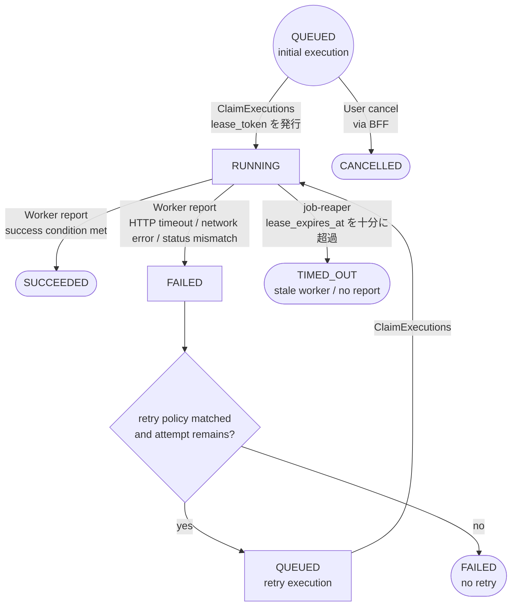
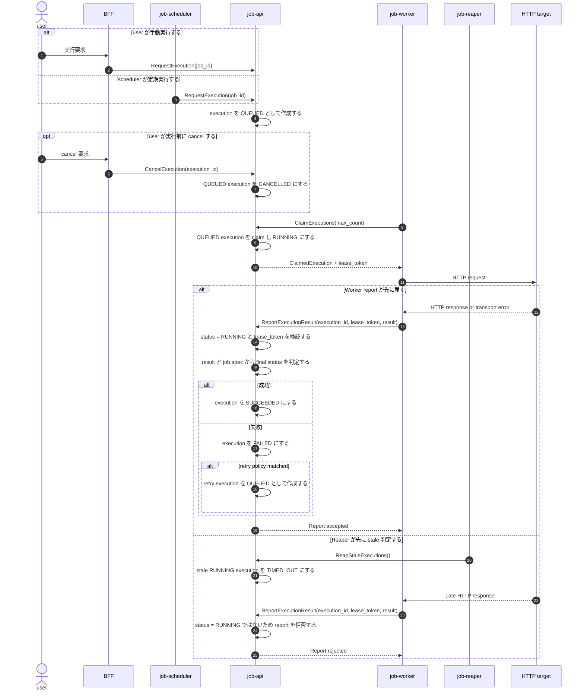

# Execution Lifecycle

この文書は、JobDeck における execution のライフサイクルを整理するための設計メモです。

`design.md` はプロジェクト全体の構想を扱うため、ここでは execution、retry、timeout、
stale worker の扱いに絞って記録します。

## ステータスモデル

`execution.status` は execution row の大まかな状態を表します。

```text
QUEUED
  Worker に claim されるのを待っている状態。

RUNNING
  Worker が claim し、現在の lease_token を所有している状態。

SUCCEEDED
  Worker が result を report し、job-api が job の成功条件を満たしたと判定した状態。

FAILED
  Worker が result を report し、job-api が job の成功条件を満たしていないと判定した状態。

TIMED_OUT
  Worker から report が来ないまま lease timeout した状態。
  job-reaper が RUNNING execution を timeout と判断した場合に設定する。

CANCELLED
  completion 前に cancellation された状態。
  初期実装では QUEUED の cancellation を対象にする。
```

`TIMED_OUT` は stale worker / no report を表すため、将来的には `STALE` に rename する余地があります。
ただし、現時点では status を増やさず `TIMED_OUT` として扱います。

## 状態遷移

現在想定している execution の状態遷移は以下です。



`FAILED` から retry する場合でも、元の execution row は再利用しません。
新しい execution row を `QUEUED` として作成します。

初回投入の `QUEUED` は開始点なので circle 型で表します。
`SUCCEEDED`、`TIMED_OUT`、`CANCELLED` は終了状態なので、Mermaid の terminal point
として stadium 型で表します。
`FAILED` は retry 判定を挟み、retry しない場合だけ終了状態として表します。

## 実行シーケンス

job-scheduler、user、worker、reaper を含めた実行シーケンスは以下です。



`ReportExecutionResult` は `lease_expires_at` だけでは拒否しません。
`status = RUNNING` と `lease_token` の一致を見ます。
そのため、reaper より先に report が届けば遅延 report でも受け入れられます。
一方で、reaper が先に `TIMED_OUT` へ更新した場合は、同じ `lease_token` であっても
`status = RUNNING` 条件に合わないため report は拒否されます。

## Claim

Worker は DB を直接読んだり更新したりしません。
実行対象の取得は `ExecutionQueueService` 経由で行います。

claim の流れは以下です。

1. `next_run_at` が到来している `QUEUED` row を選ぶ
2. `FOR UPDATE SKIP LOCKED` で row を lock する
3. status を `RUNNING` に更新する
4. 新しい `lease_token` を発行する
5. `lease_expires_at` を設定する
6. execution event を追加する

`lease_token` は、その claim に対して result を report する権限を表します。

## Report

Worker は `ReportExecutionResult` 経由で execution result を report します。

report は以下を満たす場合に受け入れます。

```text
execution_id が一致する
lease_token が一致する
status が RUNNING である
```

`lease_expires_at` だけを理由に report を拒否しません。
少し遅れて届いた report であっても、同じ `lease_token` に紐づくなら、
claim された execution の正当な result として扱います。

一方で、将来の reaper がすでに row を `RUNNING` 以外へ更新していた場合、
`status = RUNNING` 条件に合わないため report は拒否されます。

report 後の処理は job-api が所有します。

1. Worker から result を受け取る
2. job spec と result から最終 status を判定する
3. status、result、execution event を永続化する
4. retry execution を作成すべきか判定する

Worker は最終的な execution status を決めません。

## HTTP Result Mapping

HTTP job では、Worker は HTTP レベルの結果と通信エラーを report します。
job-api はその result を execution status に変換します。

```text
HTTP response status が expected_status_codes に含まれる
  -> SUCCEEDED

HTTP response status が expected_status_codes に含まれない
  -> FAILED

HTTP timeout が HTTP_ERROR_TYPE_TIMEOUT として report される
  -> FAILED

HTTP network error が HTTP_ERROR_TYPE_NETWORK として report される
  -> FAILED
```

retry 判定では status だけを見ません。
HTTP job では result の詳細も必要です。

```text
HTTP_ERROR_TYPE_TIMEOUT
  retry_on_timeout で retry 可否を決める

HTTP_ERROR_TYPE_NETWORK
  retry_on_network_error で retry 可否を決める

HTTP status code
  retry_status_codes で retry 可否を決める
```

## Retry

retry では新しい `execution` row を作成します。
元の execution row を再利用して再実行することはしません。

初期実装の retry 方針は以下です。

```text
FAILED
  result が retry policy に合致し、attempt が残っている場合は retry できる。

TIMED_OUT
  retry しない。
  Worker から report が来ていないため、実際に HTTP request が完了していた可能性がある。

CANCELLED
  retry しない。

SUCCEEDED
  retry しない。
```

`FAILED` の retry 判定では result が必要です。
一方で、`TIMED_OUT` や `CANCELLED` は `Result == nil` が正当な状態になりえます。
retry 判定では `Result == nil` を明示的に扱います。

## Stale Execution

将来的に job-reaper を追加し、`lease_expires_at` を十分に過ぎた `RUNNING` execution を
`TIMED_OUT` に更新します。

job-reaper は少し緩めに実行します。
これにより、HTTP request 自体は完了していたが report が少し遅れた、というケースでは
Worker の report を先に受け入れられます。

```text
RUNNING + worker report が先に届く
  -> SUCCEEDED or FAILED

RUNNING + reaper が先に timeout 判定する
  -> TIMED_OUT

TIMED_OUT + 遅れて worker report が届く
  -> status が RUNNING ではないため report を拒否する
```

`TIMED_OUT` は stale worker / no report を表します。

```text
TIMED_OUT
  Worker から有効な report が来なかった。
  result は nil であることが自然。
```

HTTP job 自体の timeout は `TIMED_OUT` では表しません。
Worker が `HTTP_ERROR_TYPE_TIMEOUT` と `HttpError.Message` を report し、
job-api は status を `FAILED` にします。

## Cancellation

cancellation は保守的に扱います。

```text
QUEUED -> CANCELLED
  初期実装の対象。

RUNNING -> CANCELLED
  Worker cancellation、lease handling、late report の扱いを設計してから対応する。
```

`CANCELLED` execution は retry 対象にしません。
